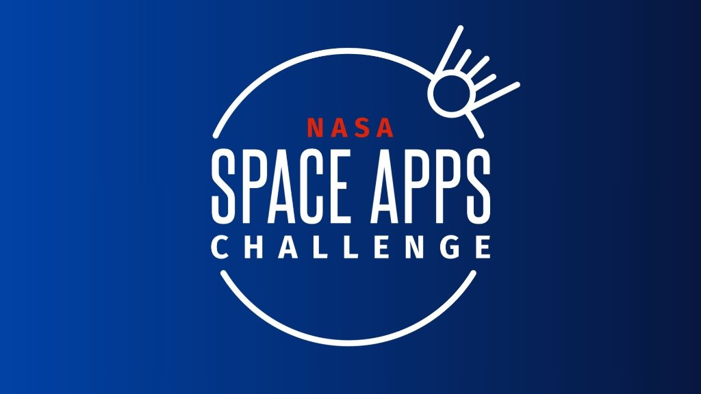
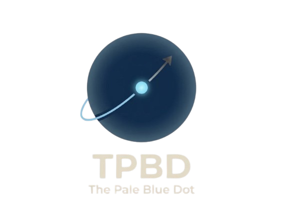

<div align="center">
  
  <br /><br />
  
  <h1>TPBD — The Pale Blue Dot</h1>
  <h3><em>Earth System Trend Detective</em></h3>
  <p><strong>NASA Space Apps Challenge 2026</strong> | Challenge Track: <em>Be An Earth System Trend Detective!</em></p>

  <p>
    <a href="https://desktop-nastex.vercel.app"></a>
    <a href="https://tpbd.onrender.com/health"></a>
    <a href="https://github.com/nastex123/tpbd"></a>
  </p>

  <p>
    
    
    
    
    
    
    
    
    
    
  </p>
</div>

---

## 🌟 Live Deployments & Project Links

* **Live Web & Desktop App:** [`https://desktop-nastex.vercel.app`](https://desktop-nastex.vercel.app) *(currently requires Vercel authentication for preview access)*
* **Backend Health & Diagnostics:** [`https://tpbd.onrender.com/health`](https://tpbd.onrender.com/health)
* **Interactive OpenAPI Swagger Docs:** [`https://tpbd.onrender.com/docs`](https://tpbd.onrender.com/docs)
* **Official GitHub Repository:** [`https://github.com/nastex123/tpbd`](https://github.com/nastex123/tpbd)

---

## 🌍 Project Identity & Genesis

### *Why an Earth observation detective tool rather than a deep space mission?*

> *"¿Y por qué decidimos hacer este proyecto y no uno de exploración espacial?"*  
> **"Porque hay que cuidar este pequeño punto pálido azul del que hablaba Carl Sagan. Antes de pensar en el espacio exterior, debemos pensar en el interior del planeta Tierra, nuestro único hogar."**  
> — *The TPBD Development Team (NASA Space Apps Challenge 2026)*

**TPBD (The Pale Blue Dot)** was conceived and developed exclusively for the **NASA Space Apps Challenge 2026** under the challenge track **"Be An Earth System Trend Detective!"**.

While the cosmos beckons with infinite frontiers, our existence depends entirely on the thin, fragile atmospheric membrane and delicate biogeochemical cycles enveloping our home planet. Humanity cannot navigate the stars if it loses the cradle that sustains it. TPBD harnesses NASA's premier Earth observing constellations and atmospheric reanalysis grids to empower scientists, students, and citizens to uncover real, long-term climate signals beneath weather noise.

---

## 🔬 How We Developed Our Tool & Solution

### 1. The Core Scientific Challenge
Detecting genuine environmental trends across Earth's climate system is fraught with mathematical pitfalls:
* **Steep Annual Seasonality:** Monsoon cycles and summer/winter transitions generate massive cyclical swings that deceive ordinary linear regressions.
* **Serial Autocorrelation:** Today's weather strongly correlates with yesterday's, inflating false-positive significance rates ($p < 0.05$) in standard ordinary least squares (OLS) regressions.
* **Satellite Gaps & Outliers:** Cloud cover, sensor degradation, and extreme weather events cause missing observations or severe anomalies.
* **Complex Teleconnections:** Atmospheric dynamics (e.g., Hadley cells, ENSO, polar amplification) mean changes in one hemisphere create coupled responses thousands of kilometers away.

### 2. The Statistical Engineering Solution
To solve this, TPBD implements a non-parametric mathematical engine decoupled from subjective modeling:
* **Seasonal Mann-Kendall Test (Hirsch-Slack):** Divides 40-year records into 12 calendar seasons, computing Kendall's $S$ statistics and tied ranks strictly within identical months. It applies lag-1 autocorrelation correction (Hamed-Rao) to ensure true statistical independence.
* **Sen's Slope Estimator ($Q_{med}$):** Computes the median of all pairwise slopes within seasons to yield an impervious, robust rate of change expressed in physical units per decade ($\Delta \text{unit}/\text{decade}$) alongside exact 95% confidence intervals.
* **Standardized Climatological Departures (WMO Z-scores):** Compares monthly observations against World Meteorological Organization (WMO) 1991–2020 normal baselines ($z = (x - \mu_m) / \sigma_m$), highlighting severe droughts, heatwaves, or deluge events without seasonal distortion.
* **Pettitt's Non-Parametric Changepoint Detection:** Pinpoints exact transition years when an ecosystem underwent an abrupt regime shift.
* **Zero Synthetic Hallucination:** Missing sensor flags (`-999`) are strictly treated as `null` with explicit `"quality": "missing"`. If observations are insufficient, the system emits an unambiguous `"status": "not_evaluable"` with clear rationale rather than fabricating synthetic points.

### 3. The 3D Digital Twin & Thematic Visualizer
* **Dynamic 3D WebGL Globe:** Built on Three.js and React-Globe.gl, featuring 60fps hardware-accelerated rendering of the Earth with atmospheric scattering, topography relief bump mapping, and orbital cloud shadows.
* **Variable-Adaptive Thematic Visor Layers:** Selected study regions feature floating 3D volumetric layers tailored to each parameter:
  * **Precipitation (`PRECTOTCORR`):** Meteorological Doppler radar layer with reflectivity color ramps (cyan $\to$ emerald $\to$ yellow $\to$ red $\to$ magenta), 75 km / 175 km geodesic range rings, and cardinal crosshairs.
  * **Temperature (`T2M`, `MOD11A1_LST`, `NCEI_TAVG`):** Infrared thermal imaging visor (glacial blue $\to$ warm amber $\to$ heatwave red).
  * **Vegetation (`MOD13Q1_NDVI`):** Photosynthetic chlorophyll canopy density (arid grey $\to$ lime green $\to$ lush rainforest emerald).
  * **Soil Moisture (`GWETROOT`) & Evapotranspiration (`EVPTRNS`):** Hydro-saturation and ascending latent heat flux visors.
* **Continuous Timeline Playback:** Scrubbing or playing the 1981–2025 timeline continuously updates the region's 3D visor color in real-time synchronized with authentic satellite observations.
* **Teleconnection Arcs:** Luminous geodesic trajectories elevated above the terrain connect opposing global biomes (e.g., Congo Basin vs. Mediterranean, Arctic vs. Amazon) to analyze spatial divergence.

### 4. IPCC AR6 CMIP6 Forward Climate Engine
* Extrapolates historical observational baselines through 2100 across three IPCC Sixth Assessment Report Shared Socioeconomic Pathways: **SSP1-2.6** (sustainable aggressive mitigation), **SSP2-4.5** (middle of the road), and **SSP3-7.0** (high emissions / regional rivalry).
* Extends all 6 catalog variables with physical equations incorporating polar amplification ($A(\phi) = 1 + 1.25 \sin^2 \phi$), monthly solar modulation, and coupled atmospheric oscillations.
* Cinema Lightbox Modal provides unified full-screen comparative analytics with dynamic 2026 cutover markers.

### 5. Multimodal Scientific AI Copilot
* Leverages Google Gemini models to deliver real-time Mission Control audio telemetry voiceover and natural language scientific explanations.
* Strictly bounded to computed observational numbers and peer-reviewed climate literature to eliminate hallucinations.

---

## 🛠️ Technologies & Languages Used

| Domain | Technology / Library | Purpose in TPBD |
|---|---|---|
| **Backend Core** | **Python 3.12+** | High-performance scientific computation and API serving. |
| **API Framework** | **FastAPI** | Async RESTful API with automated OpenAPI 3.1 contract generation. |
| **Data Validation** | **Pydantic v2** | Strict schema validation, data serialization, and RFC 7807 compliance. |
| **Numerical Math** | **NumPy & SciPy** | Matrix operations, variance adjustments, and statistical distribution modeling. |
| **Trend Analytics** | **pyMannKendall** | Seasonal Mann-Kendall tests and Sen's slope calculation. |
| **Persistence / Cache** | **SQLite (WAL mode)** | Parameterized local cache enabling sub-millisecond queries and zero-network offline mode. |
| **HTTP Clients** | **httpx (async)** | Asynchronous HTTP client interfacing with NASA POWER and AppEEARS with retry logic. |
| **Desktop Runtime** | **Electron 45** | Cross-platform desktop application shell with secure IPC and loopback network bridge. |
| **Frontend Framework**| **React 19 & TypeScript 5.9**| Component architecture, hooks, and compile-time type safety. |
| **3D Graphics** | **Three.js & React-Globe.gl** | 3D WebGL spherical coordinate projection, volumetric polygon visors, and orbital paths. |
| **Build & Styling** | **Vite & Tailwind CSS 4** | Sub-second HMR bundler and Mission Control dark tactical styling. |
| **Data Visuals** | **Recharts & Lucide React** | Interactive temporal charts, anomaly scatter plots, and telemetry HUD icons. |
| **AI / Multimodal** | **Google Gemini API** | Evidence-grounded trend explainers and low-latency Mission Control TTS audio. |
| **Containerization** | **Docker & Docker Compose** | Reproducible multi-stage container deployment for the Climate Engine backend. |

---

## 📡 NASA & External APIs Catalog

TPBD integrates multiple authoritative Earth observation platforms, combining satellite radiometry with numerical assimilation models:

| Provider / API | Source Agency | Parameters & Variables | Resolution & Coverage | Role in TPBD |
|---|---|---|---|---|
| **NASA POWER API** | NASA Langley Research Center | `T2M` (Air Temperature)<br>`RH2M` (Relative Humidity)<br>`PRECTOTCORR` (Precipitation)<br>`GWETROOT` (Root-Zone Soil Wetness)<br>`EVPTRNS` (Evapotranspiration Flux) | Grid: $0.5^\circ \times 0.625^\circ$<br>Temporal: 1981–2025 (Monthly)<br>Coverage: Global | Primary source for continuous 40-year surface meteorology and energy fluxes derived from MERRA-2 and CERES. |
| **NASA AppEEARS** | LP DAAC / USGS EROS | `MOD13Q1_NDVI` (Normalized Difference Vegetation Index) | Spatial: 250m<br>Temporal: 2000–2025 (16-day $\to$ Monthly)<br>Sensor: Terra MODIS | Direct satellite observation of photosynthetic chlorophyll density and canopy health across planetary biomes. |
| **CMIP6 / ESGF** | WCRP / Earth System Grid Federation | Climate Model Projections:<br>`T2M`, `PRECTOTCORR`, `GWETROOT`, `EVPTRNS`, `MOD13Q1_NDVI`, `RH2M` | Multi-model Ensemble<br>Temporal: 2026–2100<br>Scenarios: SSP1-2.6, SSP2-4.5, SSP3-7.0 | Forward physical projections anchored on historical baselines for predictive climate impact assessment. |
| **Google Gemini API** | Google DeepMind / Google AI Studio | Structured Reasoning & TTS Voiceover | Low-latency audio stream (PCM / base64) | Generates grounded scientific trend explanations and Mission Control audio telemetry voiceover. |
| **Natural Earth** | Free Vector and Raster Map Data | 110m & 50m Cultural Boundaries and Topography Elevation Tiles | Global Vector & Topography Rasters | Provides geographic boundary overlays, country polygons, and digital elevation relief bump maps. |

---

## 🏛️ System Architecture & Contract Governance

```
+------------------------------------------------------------------------------------------+
|                        TPBD Desktop Client (Electron / React 19)                         |
|                                                                                          |
|  +--------------------+  +----------------------+  +----------------------------------+  |
|  |   3D WebGL Globe   |  | Recharts Time Series |  |  CMIP6 Forward Projection Modal  |  |
|  | - Thematic Visors  |  | - WMO Z-Scores       |  |  - SSP1-2.6 / SSP2-4.5 / SSP3-7.0|  |
|  | - Doppler Radar    |  | - Pettitt Shift      |  |  - 2026-2100 Extrapolations      |  |
|  | - Range Rings      |  | - Sen's Slope Rate   |  |  - Net Change Delta Metrics      |  |
|  +--------------------+  +----------------------+  +----------------------------------+  |
|                                         |                                                |
|                                         v                                                |
|                   Strict OpenAPI 3.1 Contract (docs/openapi.yaml)                        |
+------------------------------------------------------------------------------------------+
                                          |
                              HTTP / JSON (RFC 7807)
                                          v
+------------------------------------------------------------------------------------------+
|                          FastAPI Climate Engine (apps/backend/)                          |
|                               Bound to 127.0.0.1:8000                                    |
|                                                                                          |
|  +-------------------------+  +--------------------------+  +-------------------------+  |
|  |     Catalog Service     |  |   Statistical Analytics  |  |   NASA Adapters Engine  |  |
|  | - Variable Metadata     |  | - Seasonal Mann-Kendall  |  | - NASA POWER Client     |  |
|  | - Benchmark Biomes      |  | - Sen's Slope Rate       |  | - NASA AppEEARS Client  |  |
|  | - Resolution & Grid     |  | - WMO 1991-2020 Z-Scores |  | - CMIP6 Extrapolator    |  |
|  +-------------------------+  +--------------------------+  +-------------------------+  |
|                                             |                                            |
|                                             v                                            |
|                        +-----------------------------------------+                       |
|                        | Parameterized SQLite Cache & Offline    |                       |
|                        | Pre-seeded Benchmark Fixtures (HU-14)   |                       |
|                        +-----------------------------------------+                       |
+------------------------------------------------------------------------------------------+
```

### Key Architectural Pillars:
1. **Contract-First Inviolability:** The OpenAPI 3.1 specification at [`docs/openapi.yaml`](docs/openapi.yaml) serves as the immutable single source of truth. Both backend Pydantic models and frontend query hooks derive strictly from this contract.
2. **Offline Resilience & Zero Latency:** An embedded SQLite database (`tpbd_cache.db`) stores verified observations for 12 benchmark planetary biomes (Amazon, Sahel, Mediterranean Seville, Arctic Svalbard, Aral Sea, California, etc.). If network connections drop or NASA APIs throttle, TPBD serves authentic verified observations instantly.
3. **Strict Language Policy:** 100% of the repository's code, comments, identifiers, tests, documentation, and commits are maintained in English.
4. **Defensive Security Hardening:** Validated under Cloudflare defensive security guidelines with loopback binding (`127.0.0.1`), strict CORS whitelisting, RFC 7807 sanitized error responses, and payload complexity limits ($\le 2,400$ points) to prevent DoS.

---

## 🚀 How to Run the Project

You can run TPBD locally via native tools or containerized via Docker.

### Prerequisites
* **Python:** 3.12 or higher with [`uv`](https://docs.astral.sh/uv/) (recommended) or `pip`.
* **Node.js:** 20 or higher with `npm`.
* **Git:** For cloning the repository.
* **Docker & Docker Compose:** *(Optional, for containerized backend execution)*.

---

### Method A: Native Local Execution (Recommended for Development)

#### 1. Clone the Repository
```bash
git clone https://github.com/nastex123/tpbd.git
cd tpbd
```

#### 2. Configure Environment Variables
Copy or create a `.env` file in the root directory:
```bash
# Optional: Set your Gemini API key for AI Copilot explanations and audio telemetry
GEMINI_API_KEY=your_gemini_api_key_here

# Optional: NASA Earthdata credentials for dynamic AppEEARS satellite task submission
APPEEARS_USERNAME=your_earthdata_username
APPEEARS_PASSWORD=your_earthdata_password
```

#### 3. Start the FastAPI Climate Engine (Backend)
```bash
# Navigate to the backend directory
cd apps/backend

# Using uv (fastest):
uv sync
uv run uvicorn app.main:app --host 127.0.0.1 --port 8000 --reload

# Or using standard venv and pip:
python -m venv .venv
source .venv/bin/activate  # On Windows: .venv\Scripts\activate
pip install -r requirements.txt
python -m uvicorn app.main:app --host 127.0.0.1 --port 8000 --reload
```
Verify the backend is operational:
* **Health Check:** [http://127.0.0.1:8000/health](http://127.0.0.1:8000/health)
* **Swagger UI Documentation:** [http://127.0.0.1:8000/docs](http://127.0.0.1:8000/docs)

#### 4. Start the Desktop Frontend
In a new terminal window:
```bash
# Navigate to the desktop directory
cd apps/desktop

# Install frontend dependencies
npm install

# Run the desktop app in development mode with Vite + Electron
npm run desktop

# Or run in browser mode:
npm run dev
```

---

### Method B: Docker Containerization

TPBD provides a multi-stage `Dockerfile` and `docker-compose.yml` to run the Climate Engine backend inside an isolated container with persistent cache volume mounting.

> [!NOTE]
> **Why run the backend in Docker and the frontend natively?**  
> The backend Climate Engine is a headless, high-throughput analytical service that containerizes cleanly across any operating system. The desktop frontend is an **Electron GUI application** that leverages native GPU hardware acceleration (OpenGL / WebGL 2.0 via Chromium) to render the 3D globe and volumetric radar layers smoothly at 60fps. Running the backend in Docker while running the frontend natively on your host OS provides the best of both worlds: zero-dependency backend setup with maximum graphics performance.

#### 1. Build and Run the Climate Engine with Docker Compose
From the repository root:
```bash
# Build the container image and start the service
docker compose up --build -d

# Check container logs
docker compose logs -f climate-engine
```

#### 2. Run the Desktop Frontend on Host OS
```bash
cd apps/desktop
npm install
npm run desktop
```
The desktop application will automatically discover and connect to the containerized Climate Engine on `http://127.0.0.1:8000`.

#### 3. Stop the Docker Container
```bash
docker compose down
```

---

## 🧪 Automated Test Verification

TPBD enforces rigorous automated testing across both scientific mathematical algorithms and desktop interfaces.

### 1. Backend Climate Engine Tests (pytest)
Runs 85 unit and integration tests covering Seasonal Mann-Kendall statistics, Sen's slope rates, AppEEARS adapters, cache persistence, and CMIP6 forward projections:
```bash
cd apps/backend
uv run python -m pytest -v
```

### 2. Desktop Frontend & Globe Tests (Node Native Test Runner)
Runs 39 unit tests covering 3D radar range rings, Doppler crosshairs, thematic visor generation, teleconnection geodesics, and CMIP6 scenario mapping:
```bash
npm --prefix apps/desktop run test:globe
```

### 3. Investigation Storage & Local API Tests
```bash
npm --prefix apps/desktop run test:investigations
npm --prefix apps/desktop run test:local-api
```

---

## 🔒 Security & Defensive Architecture

The Climate Engine has undergone exhaustive security auditing under Cloudflare defensive security guidelines:
* **Loopback Boundary:** Binds strictly to `127.0.0.1`, rejecting all public interface requests.
* **CORS Origin Whitelisting:** Accepts requests exclusively from authorized desktop origins (`http://127.0.0.1:1420`, `http://localhost:1420`).
* **Algorithmic Complexity Bounds:** Input time series are strictly capped at $\le 2,400$ monthly points to guarantee sub-50ms execution times and eliminate Denial-of-Service (DoS) computational exhaustion.
* **RFC 7807 Error Sanitization:** Production errors return sanitized problem details (`application/problem+json`) without leaking system paths, stack traces, or credentials.

For the comprehensive security audit, refer to [`documentation/security/cloudflare-security-audit-report.md`](documentation/security/cloudflare-security-audit-report.md).

---

## 📜 Architecture Decision Records (ADRs)

Key architectural and scientific decisions are documented under [`docs/adr/`](docs/adr/):
* **[ADR-0001:](docs/adr/0001-team-standards-api-governance-and-concurrency.md)** Team Standards, API Governance, and Concurrency Guidelines
* **[ADR-0002:](docs/adr/0002-backend-architecture.md)** Backend Architecture & Service-Repository Pattern
* **[ADR-0003:](docs/adr/0003-seasonal-climatology-z-score-anomalies.md)** Seasonal Climatology Z-Score Anomalies (WMO 1991–2020)
* **[ADR-0004:](docs/adr/0004-non-parametric-changepoint-detection.md)** Non-Parametric Changepoint Detection (Pettitt Test)
* **[ADR-0005:](docs/adr/0005-local-desktop-api-bridge.md)** Local Desktop API Bridge and Renderer Isolation
* **[ADR-0006:](docs/adr/0006-local-investigation-storage.md)** Local Investigation Storage & Export Engine
* **[ADR-0007:](docs/adr/0007-gemini-ai-smart-router.md)** Gemini AI Smart Router & Prompt Governance
* **[ADR-0008:](docs/adr/0008-multimodal-synthesis-and-mission-control-audio.md)** Multimodal Synthesis & Mission Control Audio Telemetry
* **[ADR-0009:](docs/adr/0009-structured-domain-grounding-vs-rag.md)** Structured Domain Grounding vs. Vector RAG
* **[ADR-0010:](docs/adr/0010-planetary-biomes-and-opposing-teleconnection-pairs.md)** Planetary Biomes & Opposing Teleconnection Pairs

---

## 📄 License & Dedication

**Proprietary — Developed for the NASA Space Apps Challenge 2026.**  
*Dedicated to the preservation and scientific stewardship of our Pale Blue Dot.*

Special gratitude to the **NASA Earth Science Division**, the **NASA POWER Project Team** at NASA Langley, the **LP DAAC Team** at USGS EROS, and the **Earth System Grid Federation (ESGF)** for providing open scientific access to our planet's living data.
