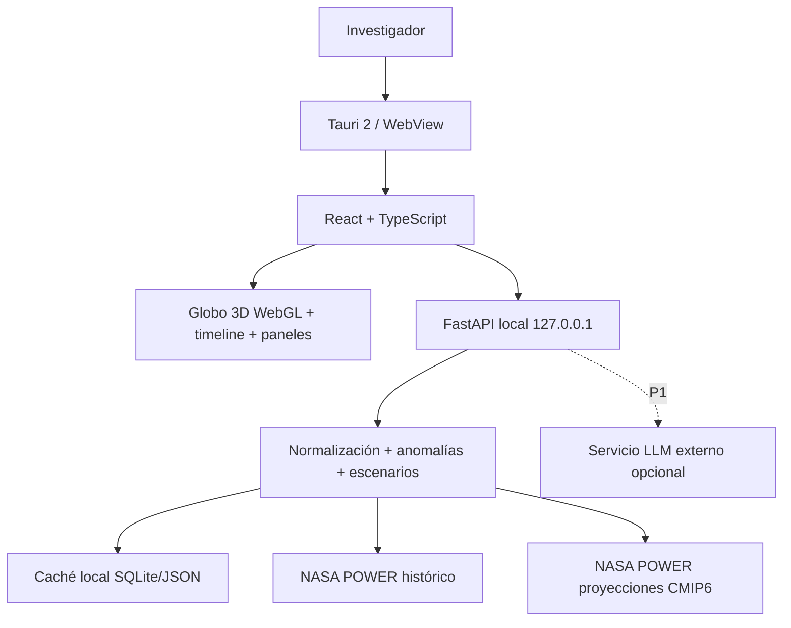
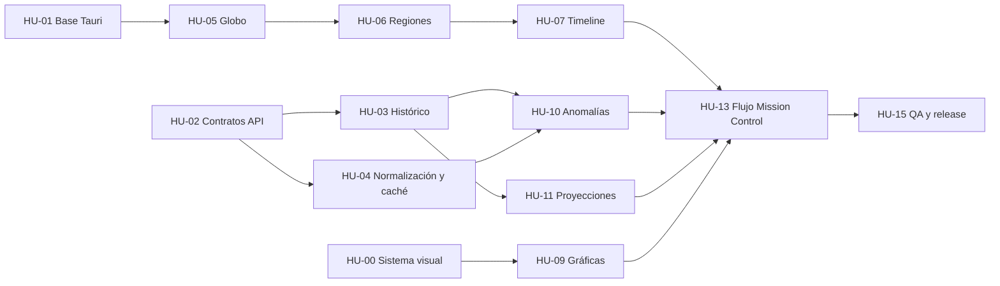

# TPBD — The Pale Blue Dot
## Roadmap técnico y de producto | Hackathon de 30 horas

**Versión:** 1.0  
**Fecha de planificación:** 14 de noviembre de 2026  
**Equipo:** Daniel (Datos/IA), Brandon (Frontend Core/Tauri), Dylan (UX/UI/Visualización)  
**Producto:** Aplicación de escritorio para Windows x64  
**Stack:** Tauri 2, React, TypeScript, Vite, Python, FastAPI, react-globe.gl, Recharts, SQLite o JSON cacheado.

## 1. Visión

TPBD es un observatorio ambiental interactivo. El usuario explora cuatro ubicaciones representativas en un globo 3D, examina series históricas de variables climáticas, identifica anomalías estadísticas y compara escenarios climáticos hasta 2050 utilizando datos y proyecciones documentados por la NASA.

**Flujo central:** DETECTAR → INVESTIGAR → SIMULAR → EXPLICAR.

**Promesa del MVP:** En una sola sesión, un evaluador puede abrir la aplicación, seleccionar una región, mover el timeline, ver variables reales históricas, detectar una anomalía, alternar tres escenarios futuros y consultar su significado, aun si se interrumpe la conexión para la demostración precargada.

## 2. Alcance

### P0: indispensable en 30 horas
1. Shell Tauri ejecutable y frontend React + TS.
2. Diseño funcional y navegación Mission Control.
3. Globo 3D optimizado con cuatro marcadores de regiones.
4. Consulta y normalización de datos mensuales históricos NASA POWER.
5. Timeline histórico 1990–2025 y años de escenario 2027–2050. El año 2026 se etiqueta según disponibilidad de datos: no se inventan meses faltantes.
6. Tres indicadores inicialmente: temperatura del aire a 2 m (`T2M`), precipitación (`PRECTOTCORR`) y humedad relativa (`RH2M`). La humedad del suelo no se equipara a RH2M.
7. Panel científico con gráficos, unidades, fuente y fecha.
8. Detección de anomalía compuesta: desviaciones estacionales de temperatura y precipitación.
9. Escenarios climáticos oficiales SSP1-2.6, SSP2-4.5 y SSP3-7.0, siempre rotulados como proyecciones de modelos CMIP6.
10. Caché y cuatro datasets de demostración.
11. Prueba integrada y entrega demostrable.

### P1: si hay holgura
- Diagnósticos explicativos mediante LLM con evidencia, sin afirmar causalidad.
- Comparador de dos fechas / regiones.
- Búsqueda arbitraria de coordenadas.
- Animación de timeline con controles de reproducción.

### P2: posteriores a la hackathon
- Exportación PDF, investigaciones guardadas, mapa global de calor continuo, índice exploratorio de estrés ambiental, capas ráster avanzadas, reportes por lotes, alertas y escenarios paramétricos de intervención calibrados por fuentes externas.

**Criterio de corte:** a partir de la hora 23 no se agrega alcance nuevo; a partir de la hora 26 solo se corrigen errores críticos y se ensaya la demostración.

## 3. Fundamento científico

- **Histórico:** NASA POWER Monthly Point, datos de reanálisis/modelos y observaciones satelitales según variable. No llamar a todos los valores «mediciones directas». El servicio mensual documenta meteorología desde 1981 y disponibilidad hasta el año anterior; verificar los años concretos al construir el fixture.
- **Proyecciones:** NASA POWER Projection API basada en NEX-GDDP-CMIP6. Escenarios oficiales: `ssp126`, `ssp245`, `ssp370`. Datos mensuales 2015–2100; resolución aproximada 0.25° con selección de la celda más cercana; evitar afirmar precisión puntual.
- **Variables comunes para histórico/futuro:** `T2M`, `PRECTOTCORR`, `RH2M`, sujetas a comprobación de series reales al implementar.
- **Anomalías:** calcular medias y desviaciones estándar por mes calendario en la climatología de referencia 1991–2020. No comparar agosto directamente con todos los meses del año. Umbrales iniciales: `z(T2M) >= +2` y `z(PRECTOTCORR) <= -1.5` simultáneamente; son heurísticos visibles y configurables, no indicadores de incendios o desastres confirmados.
- **Futuros:** no extrapolar ingenuamente una regresión hasta 2050 si ya hay escenarios climáticos publicados; en la interfaz distinguir claramente «histórico» de «proyección». No convertir un slider de emisiones en °C sin un modelo causal calibrado.
- **Casos de estudio:** seleccionar ubicaciones terrestres donde las variables atmosféricas expliquen razonablemente el caso. Propuesta: Amazonía (Manaos), La Guajira (Riohacha), Sahel (Níger) y sureste de Australia. Si se usa Groenlandia, declarar que la temperatura del aire NO mide directamente derretimiento glaciar; si se usan arrecifes, no confundir temperatura del aire con temperatura del mar.
- **Valores ausentes:** la NASA puede devolver códigos de ausencia como `-999`; normalizarlos a `null`, nunca incluirlos en promedios.

Fuentes oficiales:
- https://power.larc.nasa.gov/docs/services/api/temporal/monthly/
- https://power.larc.nasa.gov/docs/services/api/projection/
- https://v2.tauri.app/develop/sidecar/

## 4. Arquitectura propuesta



**Desarrollo:** iniciar frontend y servidor Python separadamente; definir contratos antes de integrar.  
**Distribución:** Tauri puede incluir ejecutables externos tipo *sidecar*, por ejemplo un servidor Python empaquetado con PyInstaller. Probarlo en las primeras 2 horas; requiere configurar `bundle.externalBin`, permisos del plugin shell, arranque/parada de proceso y empaquetado por plataforma. No asumir que Tauri incluye Python automáticamente.  
**Seguridad:** API local escuchando únicamente en `127.0.0.1`, validar argumentos, políticas CORS restrictivas, no incrustar claves LLM en el frontend o repositorio y no exponerlas en el instalador.

### Estructura sugerida

```text
TPBD/
├── apps/
│   └── desktop/
│       ├── src/
│       │   ├── components/{globe,timeline,charts,layout}/
│       │   ├── features/{regions,anomalies,scenarios}/
│       │   ├── services/api.ts
│       │   ├── stores/
│       │   └── types/
│       └── src-tauri/
├── services/
│   └── climate-engine/
│       ├── app/{api,clients,schemas,services,models}/
│       ├── tests/
│       └── requirements.txt
├── data/fixtures/
├── docs/{api-contract,methodology,decisions}/
└── README.md
```

### Modelo de datos básico

- `Region`: `id`, `name`, `lat`, `lon`, `description`, `variables_supported`.
- `ClimateObservation`: `region_id`, `date` (YYYY-MM), `parameter`, `value|null`, `unit`, `source`, `quality`.
- `ClimateProjection`: anterior + `scenario`, `model`, `is_projection=true`.
- `Anomaly`: `region_id`, `date`, `z_temperature`, `z_precipitation`, `is_composite`, `severity`, `explanation`, `baseline_period`.
- `DataProvenance`: `provider`, `endpoint`, `requested_at`, `source_range`, `method`, `model`, `scenario`.

### Contrato API mínimo (acordar en la hora 2)

| Método | Ruta | Respuesta esperada |
|---|---|---|
| GET | `/health` | Estado, versión, disponibilidad de caché |
| GET | `/api/regions` | Lista de regiones y coordenadas |
| GET | `/api/history?region_id=amazon&start=1990&end=2025` | Series mensuales, unidades y fuente |
| GET | `/api/anomalies?region_id=amazon` | Anomalías, z-scores y período base |
| GET | `/api/projections?region_id=amazon&start=2027&end=2050` | Tres series SSP, modelo, unidades |
| GET | `/api/status` | Estado de fuentes, última actualización y modo offline |
| POST | `/api/insights` | (P1) Texto de interpretación anclado a evidencia |

Contrato de serie estándar (ejemplo de forma, no dato real):

```json
{
  "region_id": "amazon",
  "parameter": "T2M",
  "unit": "°C",
  "source": "NASA_POWER_HISTORICAL",
  "scenario": null,
  "model": null,
  "points": [
    {"date": "2020-08", "value": null, "quality": "missing"}
  ]
}
```

La API NO debe retornar una cifra inventada si NASA no provee el dato.

## 5. Responsables y capacidad

| Integrante | Responsabilidades principales | Horas P0 estimadas | Reserva |
|---|---|---:|---:|
| Daniel | API, fuentes NASA, normalización, anomalías y CMIP6 | 27 | 3 |
| Brandon | Estructura Tauri/React, globo, selección, timeline, orquestación | 27 | 3 |
| Dylan | UX/UI, capas, gráficas, escenarios visuales, caché de demo y pitch | 24 | 6 |
| **Total** | **3 personas × 30 h** | **78 h/persona** | **12 h/persona** |

Las 30 horas se refieren a tiempo transcurrido del evento. El esfuerzo acumulado del equipo alcanza como máximo 90 horas-persona, antes de descansos y otras interrupciones. Las estimaciones son orientativas y no garantizan la entrega.

## 6. Roadmap por ventanas de ejecución

### Fase 0 — H00 a H02 | Definición y prueba de riesgo
- **Daniel:** verificar respuesta real de POWER histórico y proyecciones para UNA región; revisar parámetros y unidades.
- **Brandon:** inicializar Tauri + React + TypeScript; probar WebGL, tamaño de ventana y viabilidad de sidecar en el PC de demo.
- **Dylan:** definir layout, componentes esenciales y prototipo del flujo de 4 pantallas/estados.
- **Gate G0:** repositorio arranca; un dataset real es legible; interfaz, contratos y alcance congelados.

### Fase 1 — H02 a H06 | Vertical slice mínima
- **Daniel:** FastAPI `/health`, `/api/regions`, endpoint `/api/history` con fixture + primera consulta real.
- **Brandon:** globo con cuatro puntos de prueba y selección compartida en React.
- **Dylan:** panel de detalle con gráfica conectada inicialmente a fixtures.
- **Gate G1:** elegir Amazonas en globo y ver una serie mensual representada, aunque sea precargada.

### Fase 2 — H06 a H12 | Histórico y análisis
- **Daniel:** normalizar unidades, faltantes y caché; implementar cálculo Z-Score estacional con pruebas.
- **Brandon:** timeline 1990–2025, marcador del año, estados y llamadas a API.
- **Dylan:** capas con leyenda, tarjetas de valores y gráficas históricas.
- **Gate G2:** una anomalía histórica se reproduce consistentemente y muestra los números usados.

### Fase 3 — H12 a H18 | Escenarios futuros
- **Daniel:** integrar Projection API, validar escenarios `ssp126/ssp245/ssp370`, cachear 4 ubicaciones.
- **Brandon:** extender timeline a 2050 con distinción histórica/proyección; vincular datos al globo.
- **Dylan:** selector de escenarios y gráfica de curvas comparadas con metadatos.
- **Gate G3:** en una región, alternar escenarios cambia únicamente datos proyectados y refleja la fuente real.

### Fase 4 — H18 a H23 | Mission Control y resiliencia
- **Daniel:** endpoints estables, errores legibles, trazabilidad de fuentes y verificación de caché.
- **Brandon:** integrar selección → historial → anomalía → escenario; optimización de render.
- **Dylan:** cuatro casos precargados, modo demostración, estados vacíos/carga/error, pulido visual.
- **Gate G4:** flujo completo sin pantallas rotas; seleccionar una región y recorrer la historia en menos de 2 minutos.

### Fase 5 — H23 a H27 | Integración, QA y empaquetado
- Probar instalación y arranque en Windows, incluyendo sidecar cuando se haya validado su empaquetado.
- Verificar sincronización de timeline, unidades, etiquetas de escenarios, desconexión de red y precisión de datos.
- Comprobar funcionamiento sin depender de solicitudes NASA durante la demo.
- Congelar nuevas funciones; se permite P1 únicamente si P0 está estable.
- **Gate G5:** aplicación demostrable sobre PC de presentación y datasets precargados verificados.

### Fase 6 — H27 a H30 | Presentación y contingencia
- Preparar guion de pitch de 2 minutos con cuatro acciones visibles: detectar, investigar, simular y explicar.
- Grabar un video corto de respaldo y capturas de pantalla.
- Ensayar demo completa con Wi-Fi desconectado y modo de bajo rendimiento.
- Entregar README, ejecutable/paquete disponible, referencias de datos y metodología breve.
- **Gate G6:** el equipo puede hacer la demo incluso si NASA o el LLM no responden.

## 7. Dependencias críticas



**Regla de integración:** ningún módulo espera por el backend para iniciar UI: desarrollar contra fixtures tipados con el mismo contrato JSON. Integración temprana a horas 6, 12, 18 y 23.

## 8. Presupuesto de rendimiento objetivo (no resultados medidos)

- PC de demostración: probar en la máquina real y activar perfil de gráficos reducidos.
- Evitar un mapa de calor global continuo: 4 puntos/zonas de estudio P0.
- Renderizar el globo sólo cuando sea necesario; limitar efectos, sombras, partículas y texturas pesadas.
- Interacción de timeline con debounce o filtrado local; no disparar una petición de red por cada píxel arrastrado.
- Respuesta con datos cacheados: objetivo de interfaz perceptiblemente inmediata (< 1 s para selección precargada, tras primera carga). Medir y ajustar.
- En fallas de WebGL: vista 2D/lista de regiones funcional.
- Procesar análisis en backend sin bloquear el hilo de UI.

## 9. Riesgos y plan B

| Riesgo | Mitigación | Plan B |
|---|---|---|
| NASA responde lento/no disponible | Pre-descargar datasets y metadatos | Modo demostración 100% local |
| Projection API no ofrece una combinación prevista | Comprobar al principio región, fecha, parámetro | Reducir variables/escenarios solo a los realmente validados; no inventar |
| Empaquetado Python sidecar falla | Prototipo técnico desde H00 | Demo en PC configurado, Tauri + servidor local iniciado por script, y explicar límite de distribución |
| GPU/WebGL insuficiente | Globo simple + perfil bajo | Mapa/lista 2D de ubicaciones |
| Exceso de alcance | P0/P1/P2 y ventanas de corte | Omitir IA generativa, comparaciones y exportación |
| Resultados científicamente engañosos | Fuentes, modelo, unidades, fecha, etiquetas y faltantes visibles | Ocultar resultado no validado |
| LLM alucina causalidad | Solo interpretación con evidencia, validación | Mensajes estadísticos deterministas |

## 10. Definición de terminado (Definition of Done)

Una HU se cierra cuando: código revisado por otro integrante; compila sin errores; tipos coherentes con el contrato; funciona en fixture y datos reales cuando aplica; muestra carga/error/datos faltantes; posee al menos prueba técnica relevante o procedimiento manual reproducible; y está integrada en la rama principal sin romper otras funciones.

### Entregables finales
- Proyecto Tauri/React ejecutable para la presentación.
- Backend FastAPI funcional, con pruebas básicas.
- Fixtures/caché de cuatro regiones con origen registrado.
- README con instalación, ejecución y limitaciones.
- Documento corto de metodología: NASA histórico, CMIP6, estadística de anomalías, incertidumbre.
- Script de demo y video de respaldo.

## 11. Indicadores de éxito

1. Seleccionar una región en el globo actualiza título, valores, gráficas y anomalías sin inconsistencia.
2. El histórico y las proyecciones están visualmente separados y correctamente rotulados.
3. Cambiar de `ssp126` a `ssp370` modifica series provenientes del escenario correspondiente.
4. La anomalía enseña z-scores, fecha, línea base y no afirma causas no comprobadas.
5. Los cuatro casos de estudio funcionan sin red tras precargarse.
6. El equipo completa el flujo principal en una demo de hasta 2 minutos.
7. Aplicación estable durante tres ejecuciones consecutivas en el PC de presentación.

## 12. Evolución posterior a la hackathon

- **v1.1:** IA explicativa basada en evidencias, comparadores y exportación PDF.
- **v1.2:** investigaciones guardadas, búsquedas geográficas y análisis parametrizables.
- **v2.0:** distribución multiplataforma, análisis de más puntos/rasters, motor de capas geoespaciales e intervenciones simuladas con modelos validados.

> Nota: «predicción de catástrofes» o «causalidad del cambio climático local» NO debe afirmarse a partir de correlaciones y z-scores. La aplicación es un observatorio exploratorio con escenarios, no un sistema de alerta temprana validado.
