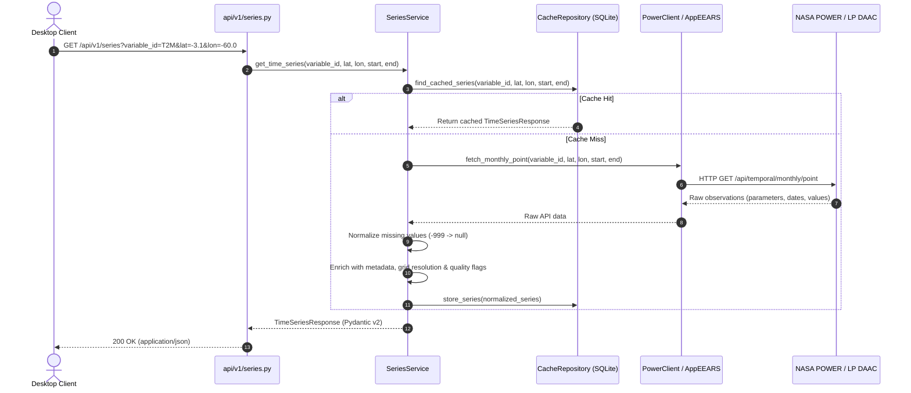
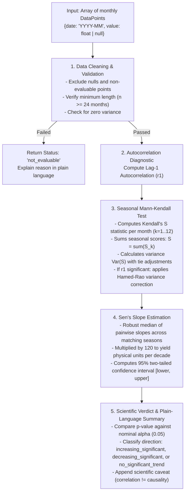

# Unified System Architecture: TPBD Climate Engine & Desktop Detective

**System:** TPBD — *The Pale Blue Dot* (Earth System Trend Detective)  
**Event:** NASA Space Apps Challenge 2026  
**Contract Authority:** [`docs/openapi.yaml`](openapi.yaml)  
**Governance ADRs:** [`docs/adr/`](adr/)  
**Owners:** Daniel (Backend & Data Science), Brandon (Desktop Core & Spatial), Dylan (UI/UX & Visual Analytics)

---

## 1. Architectural Overview & Design Philosophy

**TPBD (The Pale Blue Dot)** is built on a clean, contract-first, layered architecture. The system decouples high-performance non-parametric scientific computation (running in a local Python FastAPI Climate Engine) from rich, GPU-accelerated interactive 3D geospatial visualization and telemetry dashboards (running in an Electron desktop shell with React 19 and Three.js).

```mermaid
flowchart TD
    subgraph DesktopClient["Desktop Client (Electron + React 19 + Three.js)"]
        UI["Mission Control UI / Data Detective HUD"]
        GLOBE["3D WebGL Globe & Thematic Visors<br>(Doppler Radar, Thermal IR, Chlorophyll Canopy)"]
        SERIES["Recharts Time Series & Anomaly Inspector"]
        PROJ["CMIP6 Forward Climate Modal (2026-2100)"]
        COPILOT["Multimodal Gemini Copilot Audio Player"]
    end

    subgraph ClimateEngine["Climate Engine (FastAPI Sidecar / Container)"]
        ROUTER["1. API Layer (Routers & OpenAPI 3.1 Validation)"]
        SERVICES["2. Scientific Service Layer<br>(Mann-Kendall, Sen's Slope, Pettitt, CMIP6)"]
        CLIENTS["3. NASA Adapters (POWER & AppEEARS LP DAAC)"]
        CACHE["4. Parameterized SQLite Cache & Offline Fixtures"]
        SCHEMAS["5. Pydantic v2 Models"]
    end

    subgraph UpstreamProviders["Upstream Earth Science Data Providers"]
        POWER["NASA POWER API<br>(CERES Solar Flux & MERRA-2 Meteorology)"]
        APPEEARS["NASA AppEEARS API<br>(LP DAAC Terra MODIS 250m NDVI)"]
        ESGF["CMIP6 / ESGF / IPCC AR6<br>(Multi-Model SSP Ensemble Scenarios)"]
        GEMINI["Google Gemini API<br>(Grounded Reasoning & TTS Audio Telemetry)"]
    end

    DesktopClient <-->|HTTP / JSON (docs/openapi.yaml)| ROUTER
    ROUTER --> SERVICES
    SERVICES --> CLIENTS
    SERVICES --> CACHE
    CLIENTS --> POWER
    CLIENTS --> APPEEARS
    SERVICES --> ESGF
    SERVICES --> GEMINI
```

### Core Design Principles
1. **Contract-First Inviolability:** The OpenAPI 3.1 specification at [`docs/openapi.yaml`](openapi.yaml) is the single immutable source of truth. All endpoints, parameters, payloads, and error envelopes (`application/problem+json`) strictly adhere to it.
2. **Decoupled Scientific Mathematics:** The statistical analysis engine (`app/services/trend_service.py`) operates as pure mathematics with zero dependency on HTTP or web frameworks. It accepts numerical series and outputs deterministic statistical models.
3. **Hardware-Accelerated 3D Geospatial Visualization:** The desktop frontend leverages native WebGL 2.0 via Three.js to render a 60fps digital twin of the Earth, featuring dynamic volumetric region visors (Doppler radar, thermal infrared, NDVI canopy, hydro-saturation) and planetary teleconnection arcs.
4. **Offline Resilience:** All queries are backed by an embedded SQLite cache (`tpbd_cache.db`). Verified authentic observations for 12 benchmark planetary biomes are pre-seeded, guaranteeing instant, zero-network demonstration reliability.
5. **Defense in Depth & Cloudflare Hardening:** Enforces loopback binding (`127.0.0.1`), CORS origin whitelisting, RFC 7807 error sanitization, and strict array bounds ($\le 2,400$ points) to prevent computational exhaustion.

---

## 2. Directory Structure & Team Boundaries

To maximize developer velocity and prevent code collisions, responsibilities and paths are partitioned:

| Role / Owner | Domain Ownership | Allowed File Scopes | Forbidden Scopes |
|---|---|---|---|
| **Daniel (Backend & Data Science)** | FastAPI backend, NASA POWER/AppEEARS adapters, caching, Seasonal Mann-Kendall, Sen's slope, and CMIP6 engine | `apps/backend/**`, `tests/**`, `data/fixtures/**` | `apps/desktop/**` |
| **Brandon (Desktop Core & Spatial)** | Electron runtime, window management, WebGL 3D Globe, geolocation state, thematic region visors | `apps/desktop/src/components/globe/**`, `apps/desktop/src/stores/navigationStore.ts`, `apps/desktop/electron/**` | `apps/backend/**`, `apps/desktop/src/components/charts/**` |
| **Dylan (UI/UX & Visual Analytics)** | Data Detective design system, Recharts series, variable catalog, comparison UI, demo presets, CMIP6 UI | `apps/desktop/src/components/{charts,catalog,layout,detective}/**`, `apps/desktop/src/styles/**` | `apps/backend/**`, `apps/desktop/electron/**` |
| **Shared / Architecture** | Global documentation, API contracts, ADRs, Done Reports, Docker assets | `docs/**`, `documentation/**`, `README.md`, `docker-compose.yml` | — |

```text
tpbd/
├── apps/
│   ├── backend/                        # Daniel's Domain: FastAPI Climate Engine
│   │   ├── app/
│   │   │   ├── api/                    # HTTP Routers (health, catalog, series, analytics, ai)
│   │   │   ├── clients/                # NASA POWER and AppEEARS async HTTP clients
│   │   │   ├── core/                   # Configuration, exceptions, RFC 7807 handlers
│   │   │   ├── repositories/           # SQLite cache and curated biome metadata
│   │   │   ├── schemas/                # Pydantic v2 schemas matching openapi.yaml
│   │   │   └── services/               # Statistical engine (Mann-Kendall, Sen's slope, Pettitt, CMIP6)
│   │   ├── tests/                      # Pytest suite (85 unit and integration tests)
│   │   ├── Dockerfile                  # Multi-stage production container definition
│   │   └── pyproject.toml              # Python dependencies (uv / pip)
│   └── desktop/                        # Brandon & Dylan's Domain: Desktop Client
│       ├── electron/                   # Electron main process and local API bridge
│       ├── public/                     # High-resolution Earth textures, clouds, topography
│       ├── src/
│       │   ├── components/
│       │   │   ├── catalog/            # Variable selection catalog
│       │   │   ├── copilot/            # Gemini AI Copilot trigger and audio player
│       │   │   ├── detective/          # Holographic inspector and CMIP6 projection modal
│       │   │   ├── globe/              # Three.js / React-Globe.gl 3D visualization
│       │   │   └── navigation/         # Study region drawer and teleconnection presets
│       │   └── stores/                 # Client state management (investigations, navigation)
│       └── package.json                # Frontend dependencies (npm / vite)
├── docs/                               # Architecture contracts, ADRs, and documentation assets
│   ├── adr/                            # Architectural Decision Records (ADR-0001 to ADR-0010)
│   ├── assets/                         # NASA Space Apps and TPBD logos
│   ├── architecture.md                 # Unified system architecture (this document)
│   └── openapi.yaml                    # Single source of truth API contract
├── documentation/                      # User story done reports, QA scripts, changelogs
│   ├── changelog/                      # Daily changelog entries
│   ├── done/                           # Mandatory HU completion reports
│   └── security/                       # Cloudflare security audit report
├── docker-compose.yml                  # Root containerization service configuration
└── README.md                           # Master repository portfolio documentation
```

---

## 3. Data Flow & Execution Pipelines

### 3.1 Historical Time Series Acquisition Pipeline (`GET /api/v1/series`)



### 3.2 Scientific Statistical Pipeline (`POST /api/v1/analytics/trends`)

The statistical engine answers two fundamental questions: **By how much does it change?** (Rate of change) and **Is the trend statistically significant?** (Statistical significance):



---

## 4. 3D Geospatial Visualization & Thematic Layers

The 3D WebGL Globe component (`RegionGlobe.tsx`) is designed for 60fps real-time responsiveness:
* **Thematic Volumetric Region Visors:** Generates 3D extruded GeoJSON polygons (`altitude: 0.0075`) over active study areas. As the user scrubs or plays the timeline, the visor's cap and side colors dynamically shift based on the active variable:
  * **Precipitation (`PRECTOTCORR`):** Meteorological Doppler radar layer with reflectivity color ramps (cyan $\to$ emerald $\to$ yellow $\to$ red $\to$ magenta), 75 km / 175 km geodesic range rings, and cardinal crosshairs.
  * **Air & Surface Temperature (`T2M`, `MOD11A1_LST`):** Infrared thermal imaging scale (freezing blue $\to$ cool cian $\to$ warm amber $\to$ heatwave red).
  * **Vegetation Canopy (`MOD13Q1_NDVI`):** Photosynthetic chlorophyll density (arid grey $\to$ lime green $\to$ lush emerald).
  * **Soil Moisture (`GWETROOT`) & Evapotranspiration (`EVPTRNS`):** Hydro-saturation and ascending latent heat flux visors.
* **Teleconnection Arcs:** Elevated 3D parabolic tubes connecting paired planetary biomes (e.g., Congo Basin vs. Mediterranean Seville for Hadley Cell dynamics, Arctic Svalbard vs. Amazon for Polar Amplification).
* **High-Precision Camera Flight:** Smooth cinematic camera interpolation between planetary regions with altitude-scaling auto-framing.

---

## 5. IPCC AR6 CMIP6 Forward Climate Engine

The Climate Engine projects all 6 catalog variables forward from 2026 to 2100 across three IPCC AR6 Shared Socioeconomic Pathways:
1. **SSP1-2.6:** Aggressive mitigation; global warming stabilizes near $+1.5^\circ\text{C}$ to $+1.8^\circ\text{C}$ by 2100.
2. **SSP2-4.5:** Middle of the road; global warming approaches $+2.7^\circ\text{C}$ by 2100.
3. **SSP3-7.0:** High emissions / regional rivalry; global warming exceeds $+4.0^\circ\text{C}$ by 2100.

### Mathematical Formulation:
For any variable $V$, projection at year $y \in [2026, 2100]$ and month $m \in [1, 12]$ at latitude $\phi$ is:
$$V(y, m, \phi) = \bar{B}_m + \Delta(y) \cdot A(\phi) + S(m, \phi) + \Omega(y)$$
Where:
* $\bar{B}_m$ is the authentic historical monthly climatological baseline (2015–2025 mean).
* $\Delta(y)$ is the scenario radiative forcing trajectory ($+1.8^\circ\text{C}$ for SSP1-2.6, $+2.7^\circ\text{C}$ for SSP2-4.5, $+4.0^\circ\text{C}$ for SSP3-7.0 by 2100).
* $A(\phi) = 1 + 1.25 \sin^2 \phi$ is the non-linear polar amplification factor.
* $S(m, \phi)$ is the seasonal harmonic modulation.
* $\Omega(y)$ represents coupled multi-annual oscillations (ENSO/NAO cycles).

The **Cinema Lightbox Modal** renders these projections in a distraction-free, portal-mounted dialogue with real-time baseline, end-of-century, and net delta ($\Delta$) telemetry metrics.

---

## 6. Error Handling Architecture (RFC 7807)

All non-2xx HTTP responses adhere strictly to the **RFC 7807 Problem Details** standard specification (`application/problem+json`):

```json
{
  "type": "https://tpbd.nasa.gov/errors/insufficient-data",
  "title": "Insufficient Data for Trend Analysis",
  "status": 422,
  "detail": "The time series for variable 'T2M' contains only 8 valid observations. A minimum of 24 monthly samples is required for Seasonal Mann-Kendall evaluation.",
  "instance": "/api/v1/analytics/trends",
  "invalid_params": [
    {
      "name": "points",
      "reason": "Sample size (8) is below the minimum threshold (24)."
    }
  ]
}
```

FastAPI exception handlers map standard Python and scientific domain errors directly to this format:
* `ValidationError` $\to$ 400 Bad Request with `invalid_params`.
* `NotFoundError` $\to$ 404 Not Found.
* `NonEvaluableTrendError` $\to$ 422 Unprocessable Entity.
* `NASAUpstreamTimeoutError` $\to$ 502 Bad Gateway.

---

## 7. Persistence & Caching Strategy

The cache repository leverages an embedded **SQLite** database (`tpbd_cache.db`):
* **Zero Server Dependency:** Embedded directly into Python's `sqlite3` standard library module using Write-Ahead Logging (WAL) for concurrent read access.
* **Compound Key Indexing:** Indexed on `(variable_id, rounded_lat, rounded_lon, start_year, end_year)`.
* **JSON Column Storage:** Normalized data points and metadata stored as native JSON text, enabling instant serialization into Pydantic models.
* **Pre-Loaded Biome Fixtures:** 12 curated planetary regions (Amazon, La Guajira, Sahel, Southeast Australia, Svalbard, Aral Sea, California, Tibetan Plateau, Congo Basin, SW Greenland, Coral Sea, Mediterranean Seville) are pre-seeded in the database for guaranteed zero-latency offline demo reliability.

---

## 8. Security & Cloudflare Audit Compliance

The TPBD backend has undergone comprehensive security auditing under Cloudflare defensive security guidelines:
* **Loopback Isolation:** The server binds strictly to `127.0.0.1`, rejecting all public external network interfaces.
* **CORS Whitelisting:** Only authorized desktop origin ports (`http://127.0.0.1:1420`, `http://localhost:1420`) are accepted.
* **Algorithmic Complexity Protection:** Array payload lengths are strictly capped at $\le 2,400$ points to guarantee sub-50ms execution times and eliminate Denial of Service (DoS) vectors.
* **Sanitized Errors:** Unhandled exceptions return sanitized RFC 7807 problem details without leaking internal tracebacks, stack traces, or environment variables.

For the full security audit report, consult [`documentation/security/cloudflare-security-audit-report.md`](../documentation/security/cloudflare-security-audit-report.md).
