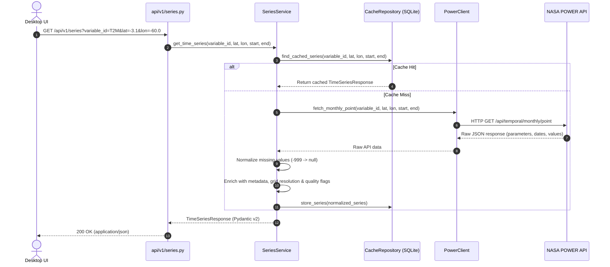
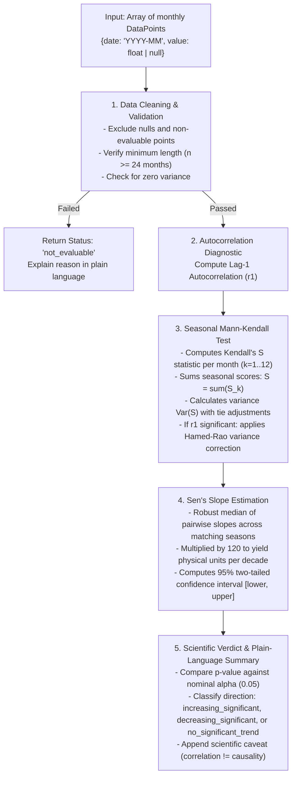

# Backend Technical Architecture: Climate Engine

**Service:** `apps/backend` (Climate Engine)  
**Framework:** FastAPI (Python 3.11+)  
**Contract Authority:** [`docs/openapi.yaml`](file:///c:/Users/LENOVO/Documents/DANI%20DOCS/tpbd/docs/openapi.yaml)  
**Governance ADR:** [`docs/adr/0002-backend-architecture.md`](file:///c:/Users/LENOVO/Documents/DANI%20DOCS/tpbd/docs/adr/0002-backend-architecture.md)  
**Owner:** Daniel (Backend & Scientific Data Engineering)

---

## 1. Architectural Overview & Design Philosophy

The Climate Engine is the analytical core of **TPBD — The Pale Blue Dot**. It runs locally on the user's workstation as a desktop sidecar or local daemon (listening strictly on `http://127.0.0.1:8000`), serving time series acquisition, statistical trend detection, and regional comparisons to the Tauri desktop frontend.

```mermaid
flowchart TD
    subgraph Frontend["Desktop Frontend (Tauri 2 + React)"]
        UI["Mission Control UI / Data Detective"]
    end

    subgraph Backend["Climate Engine (FastAPI Sidecar)"]
        API["1. API Layer<br>(Routers & Dependency Injection)"]
        SVC["2. Service Layer<br>(Scientific Math & Business Orchestration)"]
        CLIENTS["3. Client Adapters<br>(NASA POWER & AppEEARS)"]
        REPO["4. Repository Layer<br>(SQLite Local Cache & Fixtures)"]
        SCHEMAS["5. Schema Layer<br>(Pydantic v2 Models)"]
    end

    subgraph Upstream["External NASA Data Providers"]
        POWER["NASA POWER API<br>(Synchronous Point Service)"]
        APPEEARS["NASA AppEEARS API<br>(Asynchronous Batch Extraction)"]
    end

    UI <-->|HTTP / JSON (OpenAPI 3.1)| API
    API --> SVC
    API -.-> SCHEMAS
    SVC --> CLIENTS
    SVC --> REPO
    SVC -.-> SCHEMAS
    CLIENTS --> POWER
    CLIENTS --> APPEEARS
```

### Core Design Principles
1. **Contract-First & Inviolable:** Derived 100% from [`docs/openapi.yaml`](file:///c:/Users/LENOVO/Documents/DANI%20DOCS/tpbd/docs/openapi.yaml). Route paths, query parameters, payloads, and error envelopes (`application/problem+json`) cannot diverge.
2. **Layered Service-Repository Pattern:** Pure separation of concerns. Routers only validate and serialize HTTP; Services execute pure scientific calculations; Clients interface with NASA APIs; Repositories handle SQLite persistence.
3. **Pure Decoupled Mathematics:** The statistical analysis engine (`services/trend_service.py`) has zero dependency on FastAPI or HTTP networking. It takes raw numerical arrays and outputs deterministic statistical models, enabling fast, isolated unit tests.
4. **Offline Resilience:** All queries are backed by an embedded SQLite cache. If NASA APIs are slow, unreachable, or the user is demonstrating offline, the engine transparently serves verified cached data.
5. **Ponytail Minimalism (YAGNI):** No unnecessary microservices, ORMs, or speculative abstractions. Uses standard library SQLite, Pydantic v2, and established scientific packages (`pymannkendall`, `scipy`, `numpy`).

---

## 2. Directory Structure

```text
apps/backend/
├── app/
│   ├── __init__.py
│   ├── main.py                     # FastAPI application factory, CORS, lifespan
│   ├── core/
│   │   ├── __init__.py
│   │   ├── config.py               # Pydantic Settings (ports, cache path, debug)
│   │   ├── exceptions.py           # Custom exceptions & RFC 7807 handlers
│   │   └── logging.py              # Structured console logging
│   ├── schemas/                    # Pydantic v2 schemas matching openapi.yaml
│   │   ├── __init__.py
│   │   ├── common.py               # Coordinates, ProblemDetails, ValidationError
│   │   ├── catalog.py              # Variable, VariableCategory, SatelliteProduct
│   │   ├── series.py               # DataPoint, TimeSeriesResponse
│   │   ├── analytics.py            # TrendAnalysisRequest, TrendAnalysisResponse, RegionalComparison
│   │   └── integrations.py         # AppEEARSTaskRequest, AppEEARSTaskStatus
│   ├── clients/                    # External NASA API adapters
│   │   ├── __init__.py
│   │   ├── base.py                 # Async HTTP client with timeouts and retries
│   │   ├── power_client.py         # NASA POWER Monthly API adapter
│   │   └── appeears_client.py      # NASA AppEEARS task submission & status adapter
│   ├── repositories/               # Persistence & Caching
│   │   ├── __init__.py
│   │   ├── cache_repository.py     # SQLite cache engine with JSON serialization
│   │   └── region_repository.py    # Curated preset study regions metadata
│   ├── services/                   # Scientific domain logic
│   │   ├── __init__.py
│   │   ├── catalog_service.py      # Variable definitions and metadata aggregation
│   │   ├── series_service.py       # Time series acquisition, normalization, missing data handling
│   │   └── trend_service.py        # Seasonal Mann-Kendall, Sen's slope, lag-1 autocorrelation
│   └── api/                        # HTTP Routers & Dependency Injection
│       ├── __init__.py
│       ├── deps.py                 # Dependency providers (get_cache, get_power_client, etc.)
│       └── v1/
│           ├── __init__.py
│           ├── router.py           # API v1 master router
│           ├── health.py           # GET /health
│           ├── catalog.py          # GET /api/v1/catalog/*
│           ├── regions.py          # GET /api/v1/regions
│           ├── series.py           # GET /api/v1/series
│           ├── analytics.py        # POST /api/v1/analytics/*
│           └── integrations.py     # /api/v1/integrations/appeears/*
├── tests/
│   ├── __init__.py
│   ├── conftest.py                 # Shared fixtures with real NASA data samples
│   ├── unit/
│   │   ├── test_trend_service.py   # Statistical tests (positive, negative, null, ties)
│   │   └── test_normalization.py   # Missing value (-999 -> null) handling
│   └── integration/
│       ├── test_api_contract.py    # Contract testing against openapi.yaml
│       └── test_cache_repo.py      # SQLite read/write and offline fallback tests
├── pyproject.toml                  # Python package definition and dependencies
└── requirements.txt                # Pinned dependencies for PyInstaller / venv
```

---

## 3. Data Flow & Execution Pipelines

### 3.1 Interactive Time Series Acquisition Pipeline (`GET /api/v1/series`)



### 3.2 Scientific Statistical Pipeline (`POST /api/v1/analytics/trends`)

The statistical engine answers: **¿Cuánto cambia?** (Rate of change) and **¿Es significativa la tendencia?** (Statistical significance):



---

## 4. Error Handling Architecture (RFC 7807)

All non-2xx HTTP responses follow the **RFC 7807 Problem Details** standard specification (`application/problem+json`):

```json
{
  "type": "https://tpbd.nasa.gov/errors/insufficient-data",
  "title": "Insufficient Data for Trend Analysis",
  "status": 422,
  "detail": "The time series for variable 'T2M' contains only 8 valid observations. A minimum of 24 monthly samples is required for Seasonal Mann-Kendall evaluation.",
  "instance": "/api/v1/analytics/trends",
  "invalid_params": [
    {
      "name": "points",
      "reason": "Sample size (8) is below the minimum threshold (24)."
    }
  ]
}
```

FastAPI exception handlers map standard Python and scientific exceptions directly into this envelope:
- `ValidationError` $\to$ 400 Bad Request with `invalid_params`.
- `NotFoundError` $\to$ 404 Not Found.
- `NonEvaluableTrendError` $\to$ 422 Unprocessable Entity.
- `NASAUpstreamTimeoutError` $\to$ 502 Bad Gateway.

---

## 5. Persistence & Caching Strategy

The cache repository leverages an embedded **SQLite** database (`data/cache/tpbd_cache.db`):
- **Zero Server Overhead:** Built directly into Python's `sqlite3` standard library module.
- **Fast Key-Value Lookups:** Indexed on `(variable_id, rounded_lat, rounded_lon, start_year, end_year)`.
- **JSON Column Storage:** Normalized data points and metadata stored as native JSON text, allowing immediate deserialization into Pydantic models.
- **Pre-Loaded Demo Datasets:** Four curated study regions (Amazon, La Guajira, Sahel, Southeast Australia) are pre-seeded in the database for guaranteed zero-latency offline demo reliability.

---

## 6. PyInstaller & Tauri Sidecar Distribution Strategy

To bundle the Python engine as an autonomous binary executed by Tauri 2:
1. `app/main.py` provides a standalone entry point with an optional CLI flag `--port 8000`.
2. PyInstaller builds a single-folder or single-binary executable:
   ```bash
   pyinstaller --name climate-engine --onedir --clean app/main.py
   ```
3. Tauri 2 defines the executable in `src-tauri/tauri.conf.json` under `bundle.externalBin`.
4. During boot, Tauri spawns the child process and verifies readiness via `GET /health` before displaying the main window.
