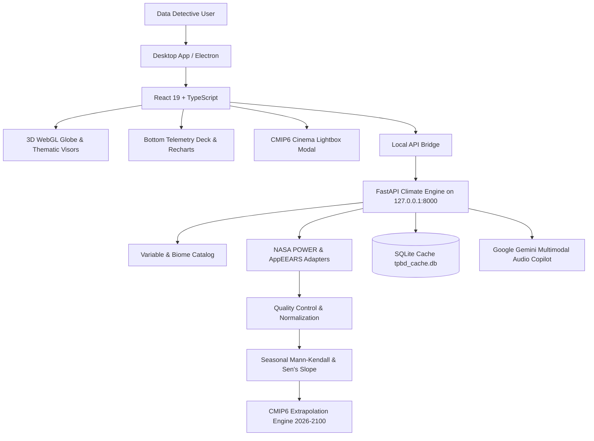

# TPBD — The Pale Blue Dot
## Technical and Product Roadmap | NASA Space Apps Challenge 2026

**Event:** NASA Space Apps Challenge 2026  
**Challenge Track:** [Be An Earth System Trend Detective!](https://www.spaceappschallenge.org/2026/challenges/earth-system-trend-detective/)  
**Engineering Domains:** Backend & Scientific Data Engineering, Desktop Core & Geospatial Engineering, UI/UX & Visual Analytics  
**Status:** Complete Implementation & Verification (FastAPI, SQLite, NASA POWER, NASA AppEEARS, Seasonal Mann-Kendall, Sen's Slope, Z-Score Anomalies, Pettitt Changepoint Detection, Gemini AI Copilot, 3D WebGL Globe with Thematic Doppler Radar Visors, and CMIP6 Forward Climate Engine).

---

## 1. Product Vision

**TPBD (The Pale Blue Dot)** transforms complex Earth observation telemetry into a structured, accessible scientific investigation workflow. Users select an Earth observation variable and a planetary region or arbitrary coordinates, inspect 40-year historical time series, compute rigorous non-parametric trend rates per decade, and evaluate whether empirical evidence supports a statistically significant monotonic trend.

**Core Investigation Flow:** Select Variable $\to$ Choose Location $\to$ Explore Time Series $\to$ Quantify Trend Rate $\to$ Evaluate Evidence & Teleconnections $\to$ Project Forward (CMIP6).

The product embodies a **Data Detective** mission console: the 3D globe and telemetry graphs guide exploration, while non-parametric statistics ensure uncompromised scientific truth.

### Key Questions Answered
1. **What is changing?** Parameter, physical unit, sensor platform, and source agency.
2. **Where is it changing?** Coordinates, curated benchmark biomes, and representative assimilation grid cells.
3. **By how much is it changing?** Robust Sen's slope in physical units per decade ($\Delta \text{unit}/\text{decade}$) with exact 95% confidence intervals.
4. **Is the trend statistically significant?** Seasonal Mann-Kendall test, p-value, serial autocorrelation adjustments, and clear non-evaluable states.

---

## 2. Prioritized Scope & Delivered Milestones

### Phase 0: Core Foundation (MVP) — Delivered
1. **Desktop Client:** Electron application with React 19, TypeScript 5.9, Vite, and local loopback API bridge.
2. **FastAPI Climate Engine:** High-performance asynchronous backend listening strictly on `127.0.0.1:8000`.
3. **3D WebGL Globe:** Hardware-accelerated Three.js globe with atmospheric scattering, topography bump relief, and orbital clouds.
4. **Curated NASA Catalog:** Variables with units, sensor platforms, spatial resolutions, temporal coverage, and physical definitions.
5. **Historical Time Series:** 1981–2025 monthly observations for arbitrary coordinates and benchmark locations.
6. **Non-Parametric Trend Engine:** Hirsch-Slack Seasonal Mann-Kendall test with lag-1 autocorrelation correction and Sen's slope rate estimator.
7. **Bivariate Regional Comparison:** Comparing identical variables between two remote locations with compatible periods and units.
8. **Offline Resilience & Fixtures:** Parameterized SQLite database (`tpbd_cache.db`) pre-seeded with authentic observations across 12 planetary biomes.

### Phase 1: Analytical Extensions — Delivered
- **WMO 1991–2020 Z-Score Anomaly Detector:** Identifies monthly standardized departures without annual cycle distortion.
- **Pettitt Changepoint & Regime Shift Detection:** Identifies exact transition years when an ecosystem underwent an abrupt structural shift.
- **Multimodal Gemini AI Copilot:** Evidence-grounded natural language trend explanations and Mission Control audio telemetry voiceover.
- **Dynamic 3D Thematic Visors:** Volumetric region layers (Doppler radar for precipitation with range rings and crosshairs, thermal infrared for temperature, chlorophyll canopy for NDVI, hydro-saturation for soil moisture, and latent heat flux for evapotranspiration).

### Phase 2: Long-Term Climate Projections — Delivered
- **CMIP6 Forward Climate Engine:** Physical extrapolation to 2100 across IPCC AR6 Shared Socioeconomic Pathways (SSP1-2.6, SSP2-4.5, SSP3-7.0) with non-linear polar amplification ($A(\phi) = 1 + 1.25 \sin^2 \phi$), seasonal harmonics, and multi-annual oscillations.
- **Cinema Lightbox Modal:** Full-screen responsive projection dashboard mounted via React portal directly to the document body.

---

## 3. Scientific Methodology & Data Governance

- **Data Sources:** NASA POWER Monthly Point (CERES solar flux and MERRA-2 meteorological assimilation) and NASA AppEEARS (Terra MODIS 250m NDVI composites).
- **Coordinate Grounding:** Clear distinction between requested point coordinates and the representative assimilation grid cell ($0.5^\circ \times 0.625^\circ$).
- **Seasonality Handling:** 12-season monthly partitioning avoids false trends caused by natural summer/winter or monsoon cycles.
- **Serial Autocorrelation:** Lag-1 autocorrelation ($r_1$) diagnostics with Hamed-Rao variance correction.
- **Rate Estimation:** Sen's slope ($Q_{med}$) computed as the median of all intra-seasonal pairwise slopes, scaled to physical units per decade.
- **Zero Synthetic Hallucination:** Missing data flags (`-999`) are normalized to `null` with explicit `"quality": "missing"`. Insufficient data yields `"status": "not_evaluable"` with clear rationale.
- **Non-Causality Principle:** Statistical significance is explicitly framed as directional correlation, never as definitive proof of physical causation or unilateral disaster attribution.

---

## 4. System Architecture

---

## 5. Risk Assessment & Mitigations

| Risk | Mitigation | Strategy Applied |
|---|---|---|
| Missing parameter for coordinate/period | Validate parameter availability by provider community | Graceful error responses and fallback to supported temporal bounds |
| Seasonal cycles distorting trend slope | Implement Hirsch-Slack Seasonal Mann-Kendall | Evaluate slopes strictly within identical calendar months |
| Serial autocorrelation inflating significance | Calculate lag-1 autocorrelation and apply Hamed-Rao correction | Adjust variance or return non-evaluable status |
| Upstream NASA network timeout during demo | Implement parameterized local SQLite cache (`tpbd_cache.db`) | Pre-seed 12 planetary biomes for zero-network execution |
| WebGL unavailable on target hardware | Provide accessible 2D spatial fallback status and selection | 2D list-based regional navigation remains fully functional |
| Unjustified causal narratives | Strict scientific caveats appended to all statistical summaries | Explicit non-causality disclosure across UI |

---

## 6. Definition of Done (DoD)

A feature or user story is considered complete only when:
1. Acceptance criteria are 100% verified with automated tests.
2. Missing observations and non-evaluable states are handled explicitly.
3. Types and contracts match [`docs/openapi.yaml`](../openapi.yaml) with zero silent mutations.
4. Data provenance and physical units are displayed alongside every numerical output.
5. A comprehensive completion report is committed under `documentation/done/<hu-id>/`.
6. Code passes automated test suites without regressions.

---

## 7. Primary Scientific References

* [NASA Space Apps Challenge: Be An Earth System Trend Detective!](https://www.spaceappschallenge.org/2026/challenges/earth-system-trend-detective/)
* [NASA POWER API Documentation](https://power.larc.nasa.gov/docs/services/api/temporal/monthly/)
* [NASA AppEEARS LP DAAC MODIS Products](https://appeears.earthdatacloud.nasa.gov/)
* Hirsch, R. M., & Slack, J. R. (1984). *A Nonparametric Test for Climatological Trends with Seasonality and Serial Correlation.* Water Resources Research.
* Sen, P. K. (1968). *Estimates of the Regression Coefficient Based on Kendall's Tau.* Journal of the American Statistical Association.
* IPCC (2021). *Sixth Assessment Report: The Physical Science Basis.* Cambridge University Press.
